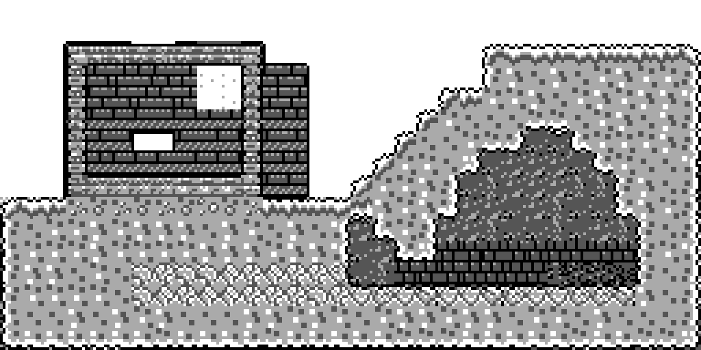
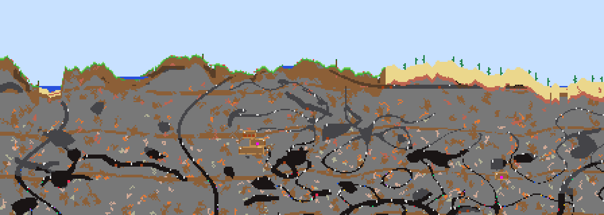

# 背景墙系统（Background Walls）

本文档说明 Terrario 的背景墙实现，并逐条对照 Terraria 官方 Wiki。内容依次为：机制说明、Wiki 对照表、测试用例、素材与授权、参考来源、已知差异。

- **事实来源**：[Official Terraria Wiki](https://terraria.wiki.gg)，以 Desktop 1.4.5 为准。页面查阅日期为 2026-11-09。引用的 Wiki 原文均保留英文，便于逐字核对。
- **不确定之处**：凡是 Wiki 没有写明、由我自行决定的细节，都在对照表的"判定"一栏标为 **未查证/近似**，并写明理由。

---

## 1. 操作

| 按键 | 作用 |
|---|---|
| `7`（使用） | 手持墙物品时：在光标处放墙。手持锤子时：敲光标处的墙 |
| `TAN` | 房屋查询。结果用 Terraria 原文显示在屏幕上方，并高亮被检测的房间；缺墙导致失败时，出问题的格子会闪烁。检测通过且房间里还没有旗帜时，会自动插上旗帜 |
| `9`（对着床） | 设置重生点。会先做卧室判定，结果用原文提示 |
| `OPTN` | 全屏地图：方块为黑色，墙按材质显示为浅灰或网点，F1 切换是否显示墙 |
| `VARS` | 墙调试菜单（`defs.h` 中 `ENABLE_WALL_DEBUG=1` 时可用），见第 5 节 |

## 2. 数据结构

- **独立图层**：每个格子有一个方块（`Tile`）和一面墙（`enum Walls`，4 bit），两者互不影响。这与 Wiki 的描述一致："Walls have their own placement layer"。
- **内存**：墙按两格一字节打包存储（`include/walls.h`）。整个 128×96 的窗口占 6 KB 堆内存，放在 `world.walls`。
- **安全墙与不安全墙**：两者在原版里是同一外观、不同 ID，这里同样处理。例如 `WALL_DIRT_NATURAL`（不安全）和 `WALL_DIRT`（安全）共用一张贴图。所有属性在 `src/wall.c` 的 `wallData[]` 表中。
- **存档**：区块文件升级为 v4，在方块数据后追加 512 B 的墙数据。旧的 v3 文件仍能读取，读入时保留方块，墙按种子重新生成，该区块随后会以 v4 重新写回。未被修改的区块不存档，加载时墙随地形一起按种子重新生成。
- **窗口移动**：窗口每次平移一个完整区块（32 格），墙层与方块层同步 `memmove`。因为 32 是偶数，打包后的半字节不会错位。

| 墙 | 安全 | 拆除掉落 | 来源 |
|---|---|---|---|
| Dirt Wall（自然） | 否 | 无 | 地表以下的 Underground 层 |
| Dirt Wall | 是 | Dirt Wall | 合成：1 Dirt → 4 |
| Stone Wall（自然） | 否 | 无 | 代表原版的各种 Cave Walls（原版共 9 种） |
| Stone Wall | 是 | Stone Wall | 合成：1 Stone → 4 |
| Wood Wall | 是 | Wood Wall | 合成：1 Wood → 4；地表小屋自带 |
| Planked Wall | 是 | Planked Wall | 锯木机：1 Wood + 1 Stone → 4；地下木屋自带，可拆下收集 |
| Glass Wall | 是 | Glass Wall | 合成：1 Glass → 4 |
| Mud Wall（自然） | 否 | 无 | 丛林地层 |
| Mud Wall | 是 | Mud Wall | 合成：1 Mud → 4 |
| Jungle Wall（自然） | 否 | 无 | 代表地下丛林的 4 种原版自然墙 |

锤子数据取自 Wiki 物品数据（Cargo 表 Items）：Wooden 25% / 工具速度 25，Copper 35% / 23，Tin 38% / 21，Iron 40% / 20。配方取自 Cargo 表 Recipes：Wooden Hammer = 8 Wood（工作台）；金属锤 = 8 锭 + 3 木头（砧）。

## 3. 渲染（视觉）

- **尺寸与外溢**：游戏中每格是 8×8 像素，每帧墙贴图是 10×10。没有同材质墙相邻的那一侧，贴图会向外溢出 1 像素并画上描边，没有缝隙；与同材质墙相邻的一侧直接衔接。这是对原版墙贴图溢出格子边界的灰度近似。Wiki 上的 placed wall 图片能看到这种不规则边缘，但具体溢出了几个像素，Wiki 没有写。
- **边缘风格**：自然墙（Dirt、Mud、Jungle）边缘参差不齐，人造墙边缘平直；玻璃墙只有细框，内部基本透明。
- **暗化**：原版的墙比方块更暗、对比度更低，并受光照影响。本机只有 4 级灰，也没有光照系统，所以每种墙统一比同材质方块暗一级（例如泥土方块用"白/浅灰"，泥土墙用"深灰/浅灰"）。
- **半透明**：Glass Wall 以透明为主，只带一道高光和稀疏网点，能透出天空或背景。其他墙不透明。
- **图层顺序**：天空或洞穴背景 → **墙** → 树冠 → 房屋旗帜 → 方块 → 放置预览 → 破坏裂纹 → 实体 → UI。这符合 Wiki 对墙的描述："depicted behind every other layer and in front of biome backgrounds"。
- **裁剪**：如果一面墙四周都连着墙，前面又是不透明且四面相连的方块，它会被完全遮住，就不画，以节省绘制时间。
- **变体**：每种材质有 3 个变体，按全局坐标哈希选取，所以窗口移动时外观不会改变。
- **缩放视图**（+/− 键）：只画墙在格子内的中心部分，不画外溢。
- **贴图生成**：全部由 `util/make_wall_sprites.py` 用程序绘制，见第 6 节。



图中左边是木墙小屋，带玻璃窗和一处 1 格的空洞；右边山体内的洞穴里有自然泥土墙；下方是 Stone、Mud、Jungle 墙。



## 4. 机制与 Wiki 对照表

**判定**一栏的含义：**一致**表示按 Wiki 原文实现；**近似**表示受本游戏条件限制做了替代；**未查证**表示 Wiki 没有写明，由我自行决定。

### 4.1 放置

| # | Wiki 原文（页面） | 实现 | 判定 | 测试 |
|---|---|---|---|---|
| P1 | "place walls manually on any tile which does not already contain a wall, given that it is adjacent to another wall or block"（Background walls） | `canPlaceWall()`：目标格无墙，且上下左右至少一格有墙或方块。水不算方块（原版里液体不是 tile） | 一致。"adjacent" 是否包括对角，Wiki 未说明，这里只算上下左右：**未查证** | T-PLACE |
| P2 | 墙在独立图层，可以放在方块后面（Placement: "Walls have their own placement layer"） | 墙层独立，在方块后面放墙不影响方块 | 一致 | T-PLACE |
| P3 | 1.0.6 "one-block holes are now automatically filled in"；1.0.6.1 "correctly taken from the player's inventory"（Background walls, History） | 放墙后检查上下左右四格，四周都有墙的 1 格空洞会被补上，每补一格消耗 1 个物品，物品用完即停 | 一致 | T-PLACE |
| P4 | 墙物品使用时间 15（Wiki Cargo 数据 usetime=15） | `WALL_USE_TIME 15` 帧，本游戏 60 帧/秒 | 一致 | — |
| P5 | Smart Cursor 只在视线内放墙（Background walls, Notes） | 本游戏没有 Smart Cursor | 未实现（见差异 D12） | — |

### 4.2 拆除

| # | Wiki 原文 | 实现 | 判定 | 测试 |
|---|---|---|---|---|
| R1 | "Walls can be removed with a hammer or explosives"（Background walls） | 锤子可以拆墙。本游戏没有炸药 | 部分（见 D4） | T-HAMMER |
| R2 | "All walls have 100 hit points each. Hitting a wall with a hammer subtracts 150 hit points multiplied by that hammer's hammer power, rounded down."（Hammers） | `hitWall()`：每次扣 `power*150/100`（整数除法，即向下取整），累计伤害达到 100 时墙被拆掉。换目标格时伤害清零 | 一致 | T-HAMMER |
| R3 | 阈值表：23–33% → 3 下，34–66% → 2 下，≥67% → 1 下（Hammers） | 测试逐项验证 33/34/66/67%，以及 4 把锤子各自需要的次数（3/2/2/2） | 一致 | T-HAMMER |
| R4 | "When breaking background walls, the tool speed of a hammer is halved, rounded down."（Hammers） | 敲到墙时 `useFrames = speed / 2` | 一致 | — |
| R5 | 不安全墙 "must be removed by starting from their edge (i.e., adjacent space with no wall)"（Background walls） | `wallIsExposed()`：周围 8 格中至少一格没有墙，才能敲。否则返回 `WALL_HIT_PROTECTED`，锤子挥空。安全墙在哪都能敲 | 一致。"adjacent" 是否包括对角：**未查证**，这里包括 | T-HAMMER |
| R6 | 自然 Dirt/Mud 墙 "does not drop as an item when destroyed"（Dirt Wall、Mud Wall）；Cave/Jungle 自然墙同样 "do not drop"（Cave Walls、Jungle Walls (natural)） | `wallData[].drop = ITEM_NULL` | 一致 | T-HAMMER |
| R7 | 玩家放置的墙拆掉后掉落物品 | 与物品一一对应，直接进入背包 | 一致。原版掉落为地面物品，这里直接进背包，与本游戏挖方块的方式一致：**近似** | T-HAMMER |
| R8 | "Naturally spawned Planked Walls can be collected by players"（Planked Wall） | 地下木屋的 Planked Wall 是安全墙，可以敲下获得物品 | 一致 | T-HAMMER |
| R9 | 墙前面有方块时 | 锤子打在方块上（原版会把方块敲成斜坡），后面的墙不受影响 | 近似（本游戏没有斜坡，见 D13） | T-HAMMER |
| R10 | 火把 "If all adjacent blocks [...] are removed (left, right, and bottom) and no wall exists behind it, it drops"（Torches） | 墙被拆、或左右下的方块被拆后，火把失去所有支撑就掉落。也可以把火把直接放在墙上（"can be placed [...] on background walls"） | 一致 | T-HAMMER |

### 4.3 碰撞与图层

| # | Wiki 原文 | 实现 | 判定 | 测试 |
|---|---|---|---|---|
| L1 | "Walls do not impede objects on any other layer"（Placement） | 墙不参与物理碰撞，也不阻挡液体流动 | 一致 | T-PLACE |
| L2 | "Walls are hidden behind everything else"（Background walls） | 渲染顺序见第 3 节 | 一致 | 场景截图 |
| L3 | 1.4.5.7 "Walls with tiles in front of them once again draw over other walls" | 墙按行顺序绘制，外溢的 1 像素可能压住相邻墙 | 近似（见 D9） | — |

### 4.4 安全墙与不安全墙

| # | Wiki 原文 | 实现 | 判定 |
|---|---|---|---|
| S1 | "The vast majority of player-placed walls are considered safe" | 所有墙物品放出的都是安全墙 | 一致 |
| S2 | "Most naturally generated walls are considered unsafe"；但 Pyramid 等结构里的自然墙是安全的 | 自然 Dirt/Stone/Mud/Jungle 墙是不安全的。世界生成的木屋、地表小屋使用安全墙 | 一致 |
| S3 | "visually identical"，"There is generally no way to distinguish safe walls from unsafe walls" | 安全墙和不安全墙共用贴图；只有调试叠加层会标出区别 | 一致 |
| S4 | "Destroying a wall and replacing it ensures that it is considered safe" | 拆掉后重新放的墙一定是安全墙 | 一致 |
| S5 | 生物群系蔓延、Clentaminator、Shimmer 产生的不安全墙 | 本游戏没有这些机制 | 不适用（见 D5） |

### 4.5 房屋判定（House, House validity evaluation）

| # | Wiki 原文 | 实现（`src/housing.c`） | 判定 | 测试 |
|---|---|---|---|---|
| H1 | 内部区域 8 方向连通；框架为 "solid blocks or platforms [...], Trap Doors, doors, or Tall Gates (only the tiles occupied when the doors are closed)" | 从查询格做 8 方向洪水填充。实心方块、平台、关着的门、开着的门的门轴列都算框架 | 一致 | T-HOUSE |
| H2 | "at least one tile occupied by a solid tile or a safe wall within the two tiles directly above/below/at the left side/at the right side of each tile (a cross with an arm length of 5 tiles)" | `crossCheck()`：内部格和框架格都要满足：以自身为中心、臂长 2 的十字范围内有实心块或安全墙 | 一致 | T-HOUSE（4×4 空洞可以，5×5 不行） |
| H3 | 缺墙提示 "This room is missing a wall"；只有不安全墙时提示 "Natural walls in this room need replacing!" | 十字检查失败时：如果范围内看到了不安全墙，给后一种提示，否则给前一种 | 一致 | T-HOUSE |
| H4 | "at least 60 but fewer than 750 total tiles, including the frame"；"width and height must not exceed 100" | 6×9 的房间（54 格）太小，6×10 的房间（60 格）可以，106 宽的房间太大 | 一致 | T-HOUSE |
| H5 | 家具：light source、table、chair、door；缺什么就在提示中列出 | 光源算火把；桌子算工作台；椅子算椅子和床；门算门和平台（"an indoor platform also works"）。提示文字逐字使用 `Game.HouseMissing_1..4` 的模板，顺序为光源、门、桌子、椅子 | 一致，但可用家具受本游戏已有物品限制（见 D11） | T-HOUSE |
| H6 | "This housing is already occupied." | 房间里已有入住 NPC 的旗帜时给出此提示 | 一致 | T-HOUSE |
| H7 | Home tile：脚下 3 格是实心块；上方 3×3 没有阻挡；从 50 分开始，门 −20，实心块 −5，空格 +5；第二轮箱子 −30、中列物体 −15；选最高分，同分取最左上 | `homeTileScore()` 按 Wiki 逐条实现。没有 evil score（本游戏没有邪恶生物群系） | 一致 | T-HOUSE |
| H8 | "Liquids will not affect the validity of a house" | 水不算框架，也不算实心 | 一致 | T-HOUSE |
| H9 | 距真实世界边缘 10 格内无效 | 窗口边缘当作世界边缘：房间必须距窗口边至少 2 格（十字检查需要读取的范围），否则提示 "This is not valid housing." | 近似（见 D8） | — |
| H10 | 1.4.5.0 "The housing query now gives visual feedback" | 被检测的房间会高亮，失败时导致失败的格子会闪烁 | 一致（表现方式不同） | 手动 M3 |

### 4.6 床与重生点（Beds）

| # | Wiki 原文 | 实现 | 判定 | 测试 |
|---|---|---|---|---|
| B1 | 卧室只需满足房屋的框架和墙规则，"other than the Bed itself, no other furniture or lighting is required" | `housingCheckBed()` 只做 H1–H4 和 H9 | 一致 | T-BED |
| B2 | "No solid blocks above the 3 tiles at the head of the Bed" | 本游戏的床宽 3 格，检查 3 格全部 | 近似（原版床宽 4 格） | T-BED |
| B3 | 提示文字：Spawn point set! / Your bedroom is too small! / … / Your bed is obstructed. | 逐字使用 Wiki 列出的 `Game.Bed*` 文本 | 一致 | T-BED |
| B4 | 再次点击同一张床会移除重生点（"Spawn point removed!"） | 未实现 | 差异（见 D14） | — |

### 4.7 NPC 入住

| # | Wiki 原文 | 实现 | 判定 | 测试 |
|---|---|---|---|---|
| N1 | "NPCs that can live in houses will spawn after [...] there is an empty valid house"；被杀后 "will not respawn until a new house becomes available"（NPCs、House） | `doNPCHouseCheck()`：只有存在已加载、通过复查的空旗帜时，NPC 才会出现并入住。新世界开局的 Guide 例外（"The Guide will appear upon starting a regular new world"） | 一致 | T-NPC |
| N2 | 房屋失效后 "the NPC will move out" | 附近放置或拆除过方块/墙的旗帜会被标记，每 3600 帧（1 分钟）统一复查一次；失效则拆掉旗帜、NPC 搬出。同时修复了原有 `removeMarker()` 删除最后一个旗帜时 NPC 不会搬出的 bug | 一致 | T-NPC |
| N3 | 墙面空余越多，NPC 入住越快（House, Notes：增加 "empty wall area" 会加快入住） | `housingTryAutoFind()` 每 20 帧在玩家附近随机抽一格，只有"空格且背后是安全墙"才会触发房屋检测。所以空墙面越多，房子越快被找到。Wiki 只描述了这个结论 | 近似：抽样范围和频率 **未查证** | T-NPC |
| N4 | 原版通过住房菜单把 NPC 指派到指定房屋 | 只有查询功能，没有指派 | 差异（见 D10） | — |

### 4.8 敌怪生成抑制（NPC spawning）

| # | Wiki 原文 | 实现 | 判定 | 测试 |
|---|---|---|---|---|
| E1 | "If the tile chosen is an unactuated solid block [...] or if it has a safe background wall behind it, the attempt is considered invalid." | `doSpawningCycle()` 随机选格后，如果该格有安全墙，这次尝试作废 | 一致 | T-SPAWN：安全墙下 20 万个周期 0 次生成，不安全墙下 253 次 |
| E2 | "the game does not check for safe background walls at the new chosen tile"（向下找地面之后不再检查墙） | 只检查最初选中的格子，向下找到的地面格不检查 | 一致 | T-SPAWN |
| E3 | 不安全墙 "will not prevent enemies from spawning" | 不安全墙不影响生成 | 一致 | T-SPAWN |

### 4.9 世界生成、地图、存档

| # | Wiki 原文 | 实现 | 判定 |
|---|---|---|---|
| G1 | "Dirt Walls generally completely cover the background at Underground depths above zero"；"At depths below zero, the backdrop [...] is generally no longer covered with actual wall tiles"（Background walls） | 地表以下 2 格到 60 格深（`WG_WALL_TOP_DEPTH` 到 `WG_CAVERN_DEPTH`）有自然墙，按所在岩石决定是泥土墙还是石墙；更深处基本没有墙。墙在挖洞之前就生成，所以洞穴保留了原来的墙 | 一致；深度数值是本游戏的地层刻度：**近似** |
| G2 | Cave Walls 出现在 "the Underground and Cavern layers" | Cavern 层按噪声零星分布不安全石墙 | 一致 |
| G3 | Mud Wall 出现在 Jungle；Jungle Walls (natural) 出现在 Underground Jungle | 丛林泥土区为 Mud Wall，地下丛林为 Jungle Wall | 一致 |
| G4 | Underground Cabin 使用 Planked Wall（Planked Wall："naturally spawns in Underground Cabins"） | 地下木屋背后铺 Planked Wall | 一致 |
| G5 | 地图上显示墙（1.2.4 "Painted walls show up properly on the map"） | OPTN 打开地图，每格 1 像素：方块黑色，墙浅灰或网点，空气白色 | 近似（见 D15） |
| G6 | 存档 | 墙随区块存档，v3 旧档可以读取；测试覆盖了窗口平移和远距离传送后再回来的情况 | — |

## 5. 调试工具（VARS）

菜单显示光标处的信息：墙的名称、安全与否、能否敲（是否在边缘）、当前锤子需要敲几下、所在房间的格数和房屋判定结果（原文提示）。

- **F1**：安全性叠加层。安全墙标一个点，不安全墙标 ×。
- **F2**：给每种墙物品各 999 个，外加一把 Iron Hammer。
- **F3 / F4**：以光标为中心，在 9×9 范围内刷上或清除当前笔刷的墙。
- **F5**：在光标处建造参考测试房屋，与自动化测试 T1 用的是同一个函数。
- **F6**：切换笔刷，包括不安全的自然墙，方便构造各种失败情况。

## 6. 测试用例

### 自动化测试（可复现）

```sh
GINT_INCLUDE=~/.local/share/fxsdk/sysroot/sh3eb-elf/include tests/run_wall_tests.sh
```

测试在 PC 上运行真实的游戏代码（除 `main.c` 和汇编优化器外的全部源文件），gint 和操作系统函数用自动生成的桩代替，存储器用内存文件系统模拟。随机种子固定，结果可复现。当前结果为 **218 checks, 0 failures**。

| 组 | 内容 |
|---|---|
| T-PLACE | 不能凭空放墙、相邻规则、不能叠放、可以放在方块后面、1 格空洞自动补墙并消耗物品、墙不产生碰撞 |
| T-HAMMER | 伤害公式、33/34/66/67% 阈值、4 把锤子所需次数、不安全墙只能从边缘拆、方块挡锤、10 种墙的掉落、火把挂墙和掉落 |
| T-HOUSE | 参考房屋有效且为 80 格、从实心块发起查询、4×4 与 5×5 空洞、全是自然墙、屋顶开洞、54/60/106 格的大小边界、缺家具的提示文本、平台当门、已入住、水、玻璃墙 |
| T-BED | 卧室有效、自然墙、床被阻挡，提示均为原文 |
| T-NPC | 没有房子时 Guide 不复活、自然墙房间不会被识别为房屋、有效房屋会被自动找到、NPC 入住、拆墙后 NPC 搬出 |
| T-SPAWN | 安全墙与不安全墙下的生成次数对比（0 次对 253 次） |
| T-CRAFT | 墙和锤子的配方 |
| T-SAVE | 世界生成出的自然墙都是不安全的、放置的墙在卸载后重新加载仍在、未修改的区块不存档、窗口平移后墙数据不错位 |

### 真机手动测试

1. **M1**：新建世界，按 VARS → F2 拿到墙物品和锤子，在空地上放墙，确认墙不能凭空放下。
2. **M2**：用 Wooden Hammer 敲墙需要 3 下，Iron Hammer 需要 2 下；地下自然墙必须从边缘开始敲。
3. **M3**：按 VARS → F5 建测试房屋，按 TAN 应提示 "This housing is suitable." 并插上旗帜。敲掉中间 5×5 的墙后再按 TAN，应提示 "This room is missing a wall"，并闪烁出问题的格子。
4. **M4**：夜间站在木墙房屋里，屋内不应刷怪；换成 F6 的自然墙后会刷怪。
5. **M5**：放一些墙后走远再走回来，或存档退出再读档，墙都应保持不变。

## 7. 素材与授权清单

| 文件 | 内容 | 来源 | 授权 |
|---|---|---|---|
| `assets-fx/img/walls/{dirt,stone,wood,planked,glass,mud,jungle}.png` | 墙贴图，16 种连接状态 × 3 个变体，每帧 10×10 | 由 `util/make_wall_sprites.py` 程序绘制，原创 | CC BY 4.0，与本仓库其他图片素材相同（见 LICENSE） |
| `assets-fx/img/swing_{wooden,copper,tin,iron}_hammer.png` | 锤子挥动帧 | 同上 | CC BY 4.0 |
| `assets-fx/img/items.png` 第 74–83 格 | 4 把锤子和 6 种墙物品的图标 | 同上，脚本只改写这 10 格。我核对过其余像素没有变化 | CC BY 4.0 |
| `docs/images/*.png` | 文档插图 | 由脚本和 `util/wgpreview.c` 生成 | CC BY 4.0 |

**仅作参考、未进入仓库的素材**：Wiki 上的 `Wood Wall (placed).png`、`Stone Wall (placed).png`、`Dirt Wall (placed).png`、`Glass Wall (placed).png`、`Planked Wall (placed).png`、`Mud Wall (placed).png`。这些图片是 Terraria 游戏贴图，版权属 Re-Logic。我只用它们目视对照风格（边缘参差、暗于方块、木板横纹、石块纹理、玻璃细框），没有复制、描摹或转换任何像素。

**文字引用**：本文引用的 Wiki 原文均为短摘录并注明页面。Wiki 文字以 CC BY-NC-SA 4.0 授权，内容源自 Terraria（© Re-Logic）。游戏内提示语为 Terraria 原文，用于对照。

## 8. 参考来源

页面均为 https://terraria.wiki.gg/wiki/ 下的条目，查阅日期 2026-11-09。原文通过 `?action=raw` 获取，提示语通过 `{{gameText|...}}` 模板展开获取，物品与配方数据通过 Cargo API 查询。

- **墙与工具**：Background_walls（含 Safe and unsafe walls 和 History 章节）、Hammers、Wooden_Hammer、Copper_Hammer
- **具体墙种**：Wood_Wall、Stone_Wall、Dirt_Wall、Mud_Wall、Glass_Wall、Planked_Wall、Gray_Brick_Wall、Cave_Walls、Dirt_Walls_(natural)、Jungle_Walls_(natural)
- **房屋与 NPC**：House（House validity evaluation、Status messages、Notes）、Beds（Setting player spawn point）、NPCs、NPC_spawning（Spawning conditions 中关于 safe background wall 的段落）
- **放置与其他**：Placement、Torches、Underground_Cabin
- **结构化数据**：Cargo 表 `Items`（hammer、usetime、toolspeed）、`Recipes`
- **提示语模板**：`TownNPCHousingFailureReasons.*`、`LegacyInterface.39/40/41`、`Game.HouseMissing_1..4`、`Game.House{LightSource,Door,Table,Chair}`、`Game.SpawnPointSet`、`Game.BedRoom*`、`Game.BedObstructed`

## 9. 已知差异

| # | 差异 | 原因 |
|---|---|---|
| D1 | 格子是 8×8 像素而非 16×16，外溢 1 像素 | 屏幕只有 128×64 |
| D2 | 只有 4 级灰；墙的"暗化"用统一暗一级的配色表示，也不受光照影响 | 硬件限制，且本游戏没有光照系统 |
| D3 | 只有 7 种材质、10 个墙 ID（原版有 300 多种）。自然墙只保留一种洞穴石墙和一种丛林墙 | 4 bit 存储，可用的贴图内存有限。架构上最多支持 16 种 |
| D4 | 不能用炸药拆墙 | 本游戏没有炸药 |
| D5 | 没有生物群系蔓延、Clentaminator、Shimmer、油漆、"不安全墙"物品（Natural Dirt Wall 等） | 本游戏没有这些系统 |
| D6 | 沙漠和海滩的沙层下没有墙（原版地下沙漠有 Hardened Sand/Sandstone 墙） | 没有沙漠墙的贴图和材料 |
| D7 | 没有 evil score、Truffle 规则、town pet、Stinkbug Blocker | 本游戏没有这些内容 |
| D8 | "距世界边缘 10 格"改为"距加载窗口边缘 2 格"。房子太靠近窗口边时会暂时判为 "This is not valid housing."，玩家走近后窗口移动就会恢复 | 无限世界只有 128×96 格在内存中 |
| D9 | 墙与墙之间的覆盖顺序没有实现 1.4.5.7 的规则 | 每帧额外排序成本太高 |
| D10 | 没有住房菜单的 NPC 指派和旗帜拖动，只有查询 | 键盘和屏幕限制，留待以后 |
| D11 | 家具只能用本游戏已有的物品（工作台算桌子，床算椅子） | 物品种类有限 |
| D12 | 没有 Smart Cursor、放置距离和视线限制 | 本游戏原本就没有这些 |
| D13 | 锤子不能把方块敲成斜坡；对着方块敲时什么也不做 | 本游戏没有斜坡和半砖 |
| D14 | 再次点击床不能取消重生点 | 待实现 |
| D15 | 地图只显示已加载的 128×96 窗口，没有探索记忆，颜色只有 4 级灰 | 内存限制 |
| D16 | 锤子的前缀不影响拆墙速度；物品堆叠上限为 999（1.4.4 起为 9999） | 沿用本游戏现有的物品系统 |
| D17 | Mud Wall 配方省略了 Ecto Mist | 本游戏没有 Ecto Mist |
| D18 | 自动找房按"随机抽样空墙格"实现，抽样范围和频率是自定的 | Wiki 只描述了结论，没有给出参数 |
| D19 | "相邻"在放墙规则里只算上下左右，在不安全墙边缘规则里包括对角 | Wiki 原文只写 "adjacent"，没有说明是否含对角 |
